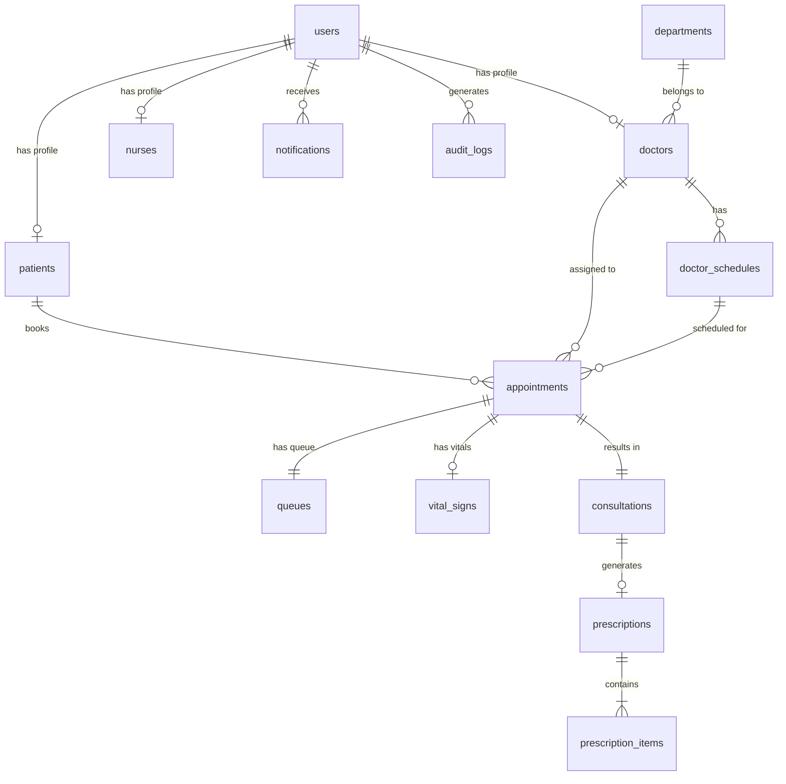

# Database Relationship Mapping - Hospital Appointment Management System

This document outlines the table relationships and entity connections for the **Hospital Appointment Management System**, complete with a Mermaid Entity Relationship Diagram (ERD).

---

## 1. Relationship Descriptions

1. **User Profile Mapping (`users` to `patients`, `doctors`, `nurses`)**:
   - **One-to-One (1:1)**: A single `users` account record can be associated with exactly one role-specific profile (`patients`, `doctors`, or `nurses`) depending on their assigned role in the system.

2. **Department to Doctors (`departments` to `doctors`)**:
   - **One-to-Many (1:N)**: One `departments` record (e.g., Cardiology) can have many `doctors` assigned to it, but each doctor belongs to one primary department.

3. **Doctor to Schedules (`doctors` to `doctor_schedules`)**:
   - **One-to-Many (1:N)**: One `doctors` profile can have multiple working `doctor_schedules` (e.g., Monday shift, Wednesday shift).

4. **Patient to Appointments (`patients` to `appointments`)**:
   - **One-to-Many (1:N)**: One `patients` record can book and maintain many `appointments` over time.

5. **Doctor to Appointments (`doctors` to `appointments`)**:
   - **One-to-Many (1:N)**: One `doctors` profile can be assigned to many `appointments` from various patients.

6. **Appointment to Queue and Consultation (`appointments` to `queues`, `consultations`)**:
   - **One-to-One (1:1)**: Each `appointments` record generates exactly one `queues` record for on-site clinic waiting management and exactly one `consultation` record upon doctor examination.

7. **Consultation, Prescriptions, and Items (`consultations` to `prescriptions`, `prescription_items`)**:
   - **One-to-One (1:1)**: Each `consultation` can result in one `prescriptions` document.
   - **One-to-Many (1:N)**: One `prescriptions` document contains many `prescription_items` (individual medicine items with dosages and instructions).

8. **User Notifications and Audit Logs (`users` to `notifications`, `audit_logs`)**:
   - **One-to-Many (1:N)**: One `users` account can receive many `notifications` and generate many `audit_logs` entries over time.

---

## 2. Entity Relationship Diagram (ERD)

