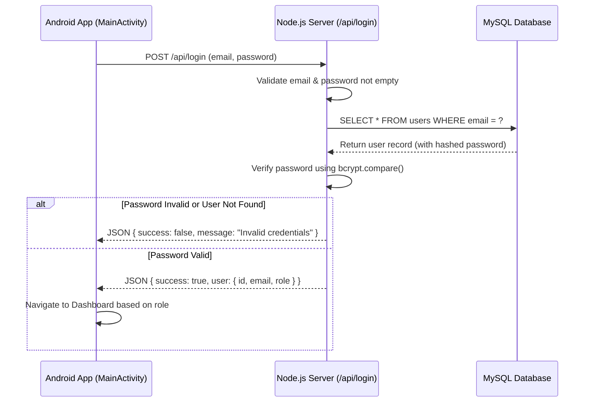
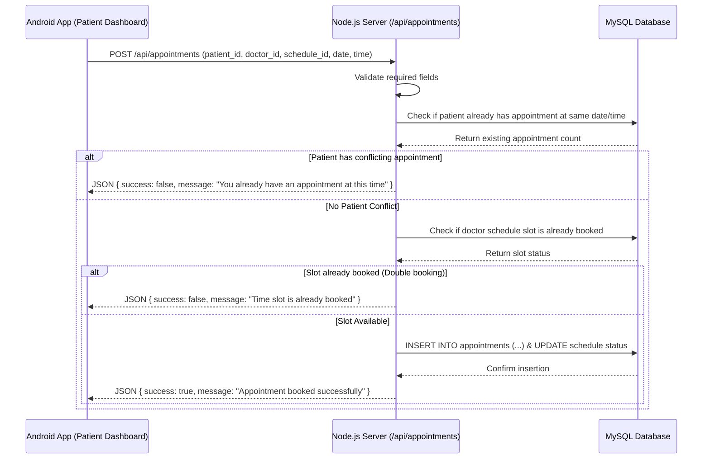
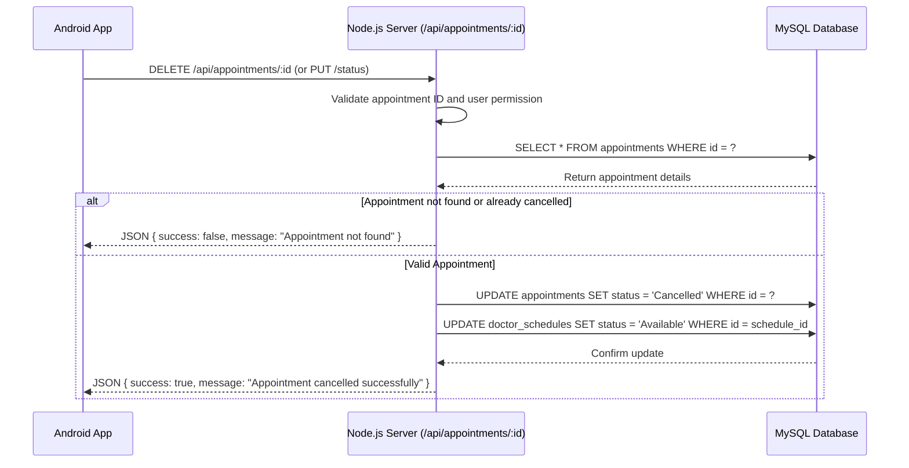
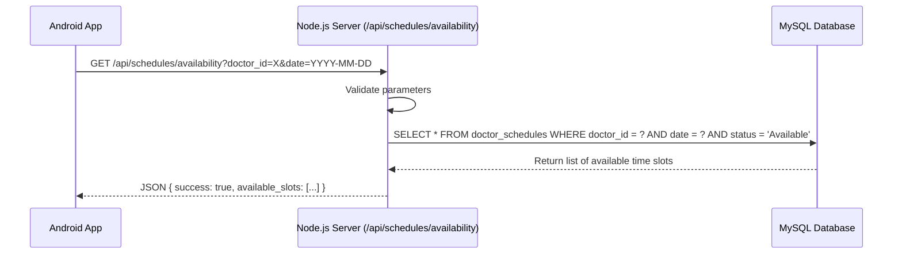

# Server Mapping and Architecture Documentation

Hospital Appointment Management System - Server-Side Documentation  
**Assigned Role:** Member 2 (Server-Side Mapping and Documentation)  
**Project Tech Stack:** Android Studio (Java) + Node.js (Backend Server) + MySQL (Database)

---

## 1. What the Server-Side Means

In our Hospital Appointment Management System, the **server-side** is the central backend engine that processes all business logic, manages database operations, and handles communication between different system users (Patients, Doctors, Nurses, and Administrators). 

While the Android application provides the user interface (UI) on the user's phone or tablet, it cannot securely or directly connect to the MySQL database. Therefore, the server-side acts as a secure middleman:
1. The Android client sends an HTTP request (e.g., patient login, booking an appointment).
2. The server receives the request, processes and validates the data.
3. The server communicates with the MySQL database to query or update records.
4. The server returns a structured JSON response back to the Android client.

---

## 2. What Node.js Does in Our Project

We use **Node.js** with **Express.js** as our backend server framework. Node.js is chosen for the following reasons:
- **Asynchronous & Fast:** Handles multiple incoming HTTP requests concurrently without blocking threads, which is ideal for real-time hospital appointments.
- **JavaScript Ecosystem:** Seamlessly parses and returns JSON objects, which matches how the Android app (using Android Volley) sends and receives data.
- **Lightweight & Modular:** Easy to organize into routes, controllers, and database connection modules.

---

## 3. How the Server Receives Requests from the Android Application

The Android app communicates with the Node.js server over HTTP/HTTPS using libraries like **Android Volley** (`JsonObjectRequest`). 
- During local development and testing, the Android emulator connects to the Node.js server running on `http://localhost:3000` by utilizing Android Debug Bridge port forwarding (`adb reverse tcp:3000 tcp:3000`).
- The Android client sends data inside the HTTP request body as a JSON payload (e.g., email, password, appointment date).
- The Node.js server uses `express.json()` middleware to parse incoming JSON bodies so that route handlers can easily read parameters.

---

## 4. How the Server Validates Information

To maintain data integrity and security, the server validates all incoming requests before interacting with the database:
- **Input Presence Checks:** Ensures required fields (e.g., email, password, doctor ID, appointment time) are not empty or missing.
- **Format Validation:** Verifies proper email formats and valid date/time strings.
- **Authentication & Authorization Checks:** Verifies user tokens (JWT or session) and checks user roles (Patient vs. Doctor vs. Nurse) to ensure unauthorized users cannot perform restricted actions (e.g., a patient cannot approve their own appointment or modify doctor schedules).
- **Business Logic Validation:** Checks schedule availability and prevents double bookings or overlapping appointments.

---

## 5. How the Server Communicates with MySQL

The Node.js server connects to the **MySQL** database using the `mysql2` Node.js package (with connection pooling).
- **Parameterized Queries:** All database queries use prepared statements and placeholders (`?`) to prevent SQL injection vulnerabilities.
- **Relational Integrity:** The database maintains foreign key relationships between tables (`users`, `departments`, `doctors`, `doctor_schedules`, `appointments`).
- **Transaction Handling:** Critical operations (such as booking an appointment and updating slot availability) can be wrapped in database transactions to ensure atomicity.

---

## 6. How the Server Returns Responses to the Android Client

The server responds to every request with a standard JSON format so the Android client can easily parse success or failure states:
- **Success Response:**
  ```json
  {
    "success": true,
    "message": "Operation successful",
    "data": { ... }
  }
  ```
- **Error Response:**
  ```json
  {
    "success": false,
    "message": "Error description or validation failure"
  }
  ```

---

## 7. Responsibilities of Each Backend Module

Our backend is organized into four core modules corresponding to the project proposal:

### A. Authentication and User Management Module
- **Patient Registration:** Registers new users, hashes passwords securely using `bcrypt`, and handles email verification codes.
- **User Authentication:** Validates login credentials against stored records and returns user profile data and roles.
- **User Roles & Permissions:** Manages role-based access control for Patients, Doctors, and Nurses.

### B. Doctor and Department Management Module
- **Manage Departments:** Add, update, and list hospital departments (e.g., Cardiology, Pediatrics, General Medicine).
- **Manage Doctors:** Register doctor profiles, assign doctors to departments, and manage doctor credentials.
- **View Doctor Information:** Retrieve detailed doctor profiles, department affiliations, and consultation fees.

### C. Doctor Schedule Management Module
- **Create & Update Schedules:** Allows doctors or administrators to set available working days, start times, and end times.
- **Check Availability:** Queries open time slots for specific doctors on specific dates.
- **Update Status:** Changes schedule statuses (e.g., Available, Booked, On Leave).

### D. Appointment Management Module
- **Book Appointments:** Allows patients to select an available doctor schedule and book an appointment slot.
- **Cancel Appointments:** Allows patients or staff to cancel an existing appointment.
- **Approve Appointments:** Allows doctors or nurses to review and approve/confirm booked appointments.
- **Constraint Enforcement:** 
  - Prevents double-booking of the same doctor time slot.
  - Prevents a patient from booking two appointments at the exact same date and time.

---

## 8. Server Process Flowcharts

### A. Patient Login Process Flow


### B. Appointment Booking Process Flow


### C. Appointment Cancellation Process Flow


### D. Schedule Availability Checking Process Flow

